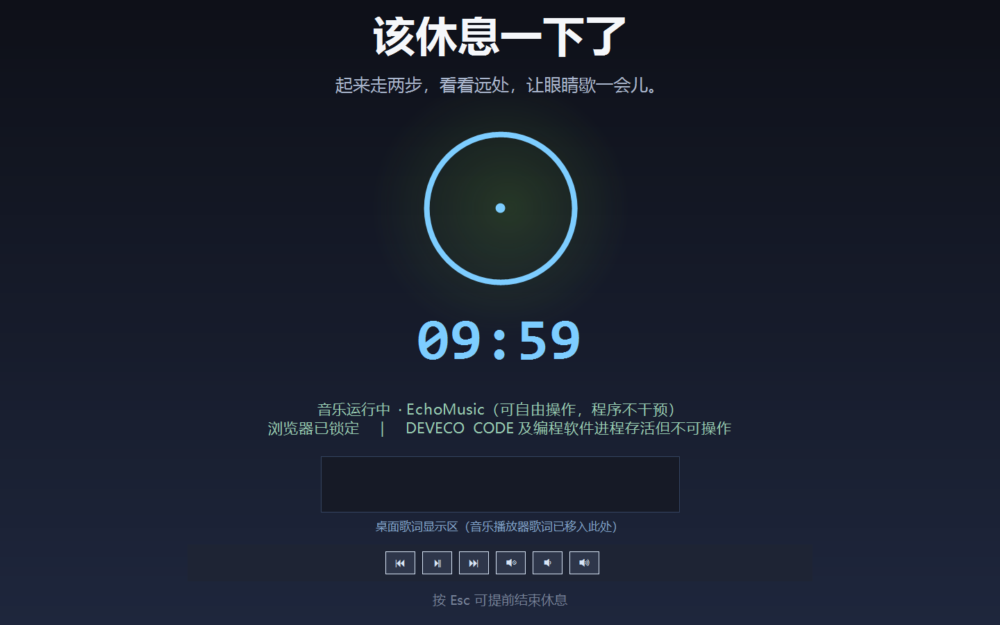

# ScreenGuard 时长管家

Windows 桌面使用时长控制程序。达到预设连续使用时长后，系统强制全屏锁定并弹出休息界面。

核心设计原则：**程序只管不该管的，不碰用户真正在用的东西。**



## 功能特性

### 1. 强制休息机制

- 可配置连续使用时长（默认 45 分钟）与休息时长（默认 10 分钟）
- 计时基于真实使用时长，支持暂停 / 继续（暂停期间不计入）
- 关闭主面板自动最小化到系统托盘，后台继续计时

### 2. 三层管控策略

休息期间对进程与窗口做**分层处理**，而不是简单地"一刀切锁死"：

| 类别 | 处理方式 | 覆盖范围 |
|---|---|---|
| **音乐播放器** | 完全放行，可听可切歌 | EchoMusic、网易云、QQMusic、Spotify、AIMP、foobar2000、PotPlayer、VLC 等 |
| **编程类软件 / 管理员白名单** | **进程活着，但窗口不可操作** | 全部 IDE、编辑器、终端、构建工具、运行时、数据库与容器工具、逆向工具 |
| **其余程序** | 休息期间隐藏 | 浏览器、办公软件、小程序宿主、模拟器等 |

**编程类软件的"活着但不能操作"**，落实为三点：

1. 进程绝不终止 —— 编译、构建、打包等后台任务全程继续跑完
2. 窗口不最小化、不隐藏 —— 还在原位，你能看见它在运行
3. 但抢不到焦点 —— 前台激活被拦截并立刻抢回休息界面，点不动、键盘也进不去

判定采用三层匹配：进程名精确匹配 → 变体匹配（`xxx64` / `xxx-x64`）→ 可执行文件路径片段匹配。

### 3. 音乐放行 + 桌面歌词搬迁

- 音乐播放器的**桌面歌词窗口会被搬进休息界面的歌词承载区**，直接显示在休息界面上
- 休息界面底部提供音乐控制条：上一首 / 播放暂停 / 下一首 / 静音 / 音量减 / 音量加
  （通过 Windows 标准 `WM_APPCOMMAND` 媒体控制命令发送）
- 歌词窗可能稍晚才创建，程序会持续重试搬运
- 休息结束后歌词窗口自动归位到原位置
- 音乐进程**不会被暂停、恢复、静音或终止** —— 你想关就自己关

### 4. B 站视频自动暂停

若 B 站正在播放视频，休息时自动暂停，**进程与页面完整保留**：

- B 站独立客户端：向其窗口发送 `WM_APPCOMMAND + APPCOMMAND_MEDIA_PLAY_PAUSE`
- 浏览器中的 B 站：向浏览器窗口发送同一媒体控制命令
- 判定依据为浏览器进程存在活跃音频会话（浏览器发声即说明有媒体在播），与当前处于哪个标签页无关；窗口标题含 `bilibili` / `哔哩哔哩` 作为辅助判定

### 5. 强制锁定

从五个层面阻止操作其他程序：

1. 全屏置顶窗口覆盖整个虚拟屏幕（支持多显示器），每 500ms 重新置顶
2. 低级键盘钩子拦截 `Alt+Tab`、`Ctrl+Tab`、`Win` 键、`Win+D`、`Win+Tab`、`Ctrl+Esc`、`Alt+F4`、`F11`、`Ctrl+Shift+Esc`、`PrintScreen`
3. 受管控窗口隐藏 + 250ms 高频前台激活拦截
4. 编程软件窗口保持原位但抢不到焦点
5. 休息界面强制压在最顶层（对抗自带 `WS_EX_TOPMOST` 的 UWP 宿主、模拟器等）

## 环境要求

- Windows 10 / 11（x64）
- .NET 8 SDK（仅构建需要；发布的 exe 自包含，无需运行时）

## 构建

```bash
git clone https://github.com/Huangzihengcmd/ScreenGuard.git
cd ScreenGuard

dotnet publish -c Release -r win-x64 --self-contained true \
  -p:PublishSingleFile=true \
  -p:IncludeNativeLibrariesForSelfExtract=true \
  -p:EnableCompressionInSingleFile=true \
  -p:DebugType=none \
  -o publish
```

产物为单个自包含 exe（约 66 MB），**目标机器无需安装 .NET 运行时**。

## 使用

```
ScreenGuard.exe            正常启动
ScreenGuard.exe --selftest  能力自检（部署守卫 / 分层识别 / 浏览器识别）
ScreenGuard.exe --resttest  休息流程逐环节验证
ScreenGuard.exe --allowtest 分层行为验证（放行对象是否被误伤）
ScreenGuard.exe --placertest 歌词搬迁与置顶验证
ScreenGuard.exe --shot     真实界面渲染截图
ScreenGuard.exe --preview   布局示意图
ScreenGuard.exe --e2e      端到端验证（真实进入休息并抓屏）
```

所有测试命令**均不进入全屏锁定**，不会干扰正在使用的工作。

托盘图标菜单：显示主面板 / 立即休息 / 退出。

## 配置

配置文件位于 exe 同级目录的 `config.json`：

```json
{
  "WorkMinutes": 45,
  "RestMinutes": 10,
  "AutoStart": false,
  "AllowEarlyExit": false,
  "ProtectedProcesses": ["deveco"],
  "ProtectedPathHints": ["@deveco"],
  "BrowserProcesses": ["msedge", "chrome", "firefox"],
  "MusicProcesses": ["EchoMusic", "cloudmusic", "qqmusic"],
  "DevProcesses": ["deveco", "Code", "idea64", "node", "python"],
  "BilibiliProcesses": ["bili", "bilibili"]
}
```

进程名写与不写 `.exe` 后缀均可，程序会自动归一化。

## 部署位置约束

程序**只允许运行在 E 盘**。启动时自检 exe 所在盘符，不在 E 盘则拒绝启动（退出码 `2`）。

如需部署到其他盘符，修改 `Core/Deployment.cs` 中的 `RequiredDrive` 常量后重新构建。

## 实现要点

几个值得记录的技术细节，踩过的坑：

**Dock 布局会吃掉后添加的控件。**
WinForms 的 Dock 布局按 z-order **反序**处理，`Dock = Fill` 的画布会先占据整个客户区，导致后添加的音乐控制条被挤成 0 尺寸（控件整个消失）。本项目统一采用**绝对定位布局**，画布不参与 Dock 计算。

**最小化窗口会引发焦点死循环。**
最小化一个窗口后，Windows 会自动把焦点转移到另一个窗口；若不加限制地反复"最小化 + 拉回焦点"，会形成 `焦点转移 → 拦截 → 最小化 → 焦点转移` 的无限循环，表现为 CPU 占用飙升、日志刷屏、界面卡死。解决方案是：拦截逻辑带 1.5 秒冷却期，且同一窗口句柄只处理一次。

**最小化挡不住错误弹窗。**
模拟器、UWP 宿主弹出的错误对话框会持续重绘并被系统反复激活，最小化后仍会闪出来挡住休息界面，还会触发 z-order 争夺。改用 `SW_HIDE` 隐藏后窗口彻底不可见，而进程照常运行（后台任务不受影响），休息结束时统一还原。

**Core Audio 会漏报独占输出。**
部分播放器（尤其是启用独占声卡的）不注册标准音频会话，`IAudioSessionManager2` 枚举不到。因此音乐状态判定改为**以进程存活为主判据**、音频会话为辅助 —— 对放行场景而言这个判据更可靠。

**置顶调用不能带 `SWP_SHOWWINDOW`。**
那等于反复 `ShowWindow`，是界面闪烁的主因。

**倒计时字号与标签高度必须匹配。**
76pt 字号单行高度约 122px，标签高度必须 ≥ 130px，否则数字会被上下裁掉。

## 已知限制

- 休息界面无法阻止关机、重启等系统级操作
- 通过任务管理器直接结束 ScreenGuard 进程可绕过管控（程序已拦截 `Ctrl+Shift+Esc` 作为常规防护）
- 音乐"是否正在发声"的判定依赖 Windows 音频会话；个别使用独占声卡输出的老式播放器可能探测不到发声状态，此时程序按"进程在运行"处理，同样完全放行
- 桌面歌词搬迁依赖歌词窗口的特征识别（标题含 `Lyric`/`歌词`/`Lrc`，或横向扁长的小浮窗）；若播放器使用自定义标题与特殊尺寸，可能无法识别

## 许可证

[MIT](LICENSE)
